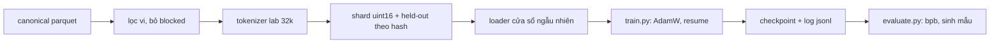

# Phase 15: Lab dense kiểu Llama

> **Required — deviation-log:** Log every Decision / Deviation / Surprise in § Deviation Log the moment it occurs.

## Context Links

- plan.md: quyết định 2026-11-15 (tiến hoá kiến trúc dense → MoE → lai Gated DeltaNet + MTP) và 2026-11-19 (thêm lab nhỏ)
- phase-10: tokenizer chính thức; lab **không** thay thế quyết định này
- Kế tiếp: [phase-16](./phase-16-lab-moe.md), [phase-17](./phase-17-lab-hybrid-gdn-mtp.md)

## Overview

Mục đích chính là **hiểu kiến trúc bằng cách tự viết và tự train**. Phase này dựng khung dùng chung cho cả ba bậc lab: dữ liệu → token → train → đo, rồi train một model dense làm **mốc** mà MoE (phase 16) và lai GDN (phase 17) phải thắng ở cùng lượng tính toán.

## Key Insights

- Máy (đo 2026-11-19): RTX 4070 12 GB, RAM 64 GB, i7-14700, Windows 11 + WSL2 Ubuntu (đang tắt). Group `eval` đã có torch 2.11+cu128, transformers, tokenizers.
- Dữ liệu dư thừa cho lab: `E:\llm-data\canonical` có fineweb2_vie 123 GB, culturax_vi 100 GB, vi_wikipedia_org 1,1 GB, owner_books 0,7 GB; `D:\LLM\data\canonical` 4,1 GB nguồn cũ. Lab chỉ cần 2–3 tỷ token.
- Tính toán theo FLOPs ≈ 6·N·D. **Đo thực (2026-11-19):** matmul bf16 đạt 59 TFLOPS; dense-S train đạt 122k token/s, tương đương ~42 TFLOPS theo cách đếm PaLM (MFU ~0,71; cách đếm này tính attention như không nhân quả nên hơi cao hơn thực tế). VRAM dùng ~1,6 GB ở S.

| Cỡ | d_model | Lớp | Head q/kv | Tham số (gồm embedding 32k) | Token | FLOPs | Thời gian |
|---|---|---|---|---|---|---|---|
| S (ablation) | 512 | 8 | 8/4 | 40,4M | 0,5B | 1,2e17 | ~70 phút (đo) |
| M (mốc) | 768 | 12 | 12/4 | ~100M | 2B | 1,2e18 | ~11–12 giờ (ước từ tốc độ S) |

- Ở cỡ này `evalset-v1` vô nghĩa (model 100M không trả lời được câu hỏi pháp luật). Thước đo chính là **bits-per-byte (bpb)** trên tập held-out: không phụ thuộc tokenizer, nên sau này so được cả với Qwen.
- Tokenizer lab là **tạm**: BPE byte-level 32k, chỉ tiếng Việt. Vocab nhỏ để embedding không chiếm phần lớn tham số của model nhỏ.
- **Lăng kính domain (chốt 2026-11-19):** ngoài bpb chung, đo bpb trên các tập held-out riêng theo domain (`law`, `health`, `culture_history`, `education`, `literature`, `news`, `forum`, `reference`, `web`). Nhờ đó mỗi bậc kiến trúc cho ra một bảng "giúp domain nào nhiều nhất", gần như không tốn thêm tính toán. Domain gán theo `source_id` trong `lab/configs/domains.yaml`, dùng khoá của `taskset/taxonomy.yaml` khi có; `literature` (sách), `news`, `forum`, `reference` (Wikipedia), `web` (dataset mở) là khoá riêng của lab.

## Requirements

- Model decoder-only tự viết bằng PyTorch thuần, đọc được từng dòng: RMSNorm pre-norm, RoPE, attention GQA qua `scaled_dot_product_attention`, FFN SwiGLU, không bias, embedding gắn với lớp đầu ra, bf16.
- `model.py` dựng stack lớp từ config theo danh sách loại lớp (`mixer: attention|gdn`, `ffn: dense|moe`), để phase 16–17 chỉ thêm loại lớp, không viết lại model.
- Dữ liệu: canonical → lọc `lang=vi`, bỏ `usage_scope=blocked` → token → shard `uint16` memmap. Held-out 1% chọn theo hash `doc_id`, không theo vị trí. Phần held-out ghi thêm thành từng tập theo domain (mỗi tập tối đa ~2M token).
- Train: AdamW, warmup + cosine, gradient clipping, tích luỹ gradient, checkpoint 30 phút một lần, **chạy lại thì tiếp tục** (máy vừa khởi động lại ngày 19/11 làm chết mọi job nền).
- Mỗi lần chạy có một file config YAML, seed, git hash; log dạng jsonl.

## Architecture

## Related Code Files

- Create: `lab/{corpus,config,tokenizer_train,data_prep,data_loader,model,train,evaluate}.py`, `lab/layers/{norm_rope,attention,mlp}.py`, `lab/configs/{dense-s,dense-m,domains,data-mix}.yaml`, `lab/configs/sweep/dense-s-lr*.yaml`
- Create: `tests/test_lab_model.py`
- Modify: `pyproject.toml`: group `lab` (torch, tokenizers, pyyaml, `triton-windows` trên Windows)
- Ngoài repo: `E:\llm-data\lab\` (tokenizer, shard token, runs, logs); chuỗi chạy `E:\llm-data\lab\logs\phase15-chain.ps1`
- Không đụng: `pipeline/`, `crawler/`, `studio/`

## Implementation Steps

1. **Môi trường**: tạo group `lab`; kiểm tra CUDA, backend nào của SDPA chạy được trên Windows, `torch.compile` có chạy được không. Đo TFLOPS thực bằng benchmark matmul bf16, rồi cập nhật bảng thời gian. Nếu `torch.compile`/Triton hỏng trên Windows thì chuyển sang WSL2, để venv và shard token trên ext4 của WSL.
2. **Tokenizer lab**: train BPE 32k trên mẫu ~2 GB (wiki + fineweb2_vie + nguồn cũ); đo fertility so với tokenizer Qwen.
3. **data_prep**: stream parquet, token hoá đa tiến trình, ghi shard và `manifest.json` (số token theo nguồn và theo domain, hash shard). Mix lab: fineweb2_vie ~60%, culturax_vi ~20%, wiki + sách + nguồn cũ ~20%. Ghi các tập held-out theo domain.
4. **Model + test**: đếm tham số khớp công thức; tính nhân quả (đổi token tương lai không làm đổi logit quá khứ); RoPE chỉ phụ thuộc vị trí tương đối.
5. **Vòng train**: kiểm tra overfit một batch (loss về ~0); kill giữa chừng rồi resume, đường loss phải nối tiếp.
6. **Chạy S**: thử 3 learning rate trên 0,1B token, chọn LR tốt nhất, chạy S đủ 0,5B token.
7. **Chạy M**: 2B token. Lưu đường bpb làm mốc cho phase 16–17.
8. **Báo cáo** `reports/lab-15-dense.md`: throughput (token/s, MFU), đường bpb, mẫu sinh, các bài học về kiến trúc.

## Todo List

- [x] Môi trường + đo TFLOPS
- [x] Tokenizer lab
- [x] Shard token + held-out
- [x] Model + test
- [x] Train loop + resume
- [x] Chạy S + quét LR
- [x] Chạy M (mốc)
- [x] Báo cáo

## Success Criteria

- [x] `uv run --group lab pytest tests/test_lab_model.py` pass (nhân quả, số tham số, RoPE, tổng byte của token = độ dài UTF-8).
- [x] Overfit một batch về loss < 0,1: 9,21 → 0,0019 sau 150 bước.
- [x] Kill rồi resume: loss bước kế tiếp lệch không quá nhiễu bình thường giữa các bước. Hai lần chạy mới giống hệt đã lệch nhau trung bình 0,013 (kernel GPU không tất định); sau resume lệch trung bình 0,008, tức resume không thêm sai lệch.
- [x] Chạy M xong: bpb/all 0,7268 (dense-S 0,8245), giảm đều không spike; mẫu sinh là câu đúng ngữ pháp, nhưng lặp vòng khi lấy mẫu không có phạt lặp.
- [x] Báo cáo `reports/lab-15-dense.md` có bảng bpb theo domain của dense-S và dense-M.

## Assumptions

- ~~**Claim:** RTX 4070 đạt ~15 TFLOPS bf16 hiệu dụng.~~ Đã đo: ~42 TFLOPS hiệu dụng ở S (xem Key Insights).
- ~~**Claim:** `torch.compile` chạy được trên Windows qua `triton-windows`.~~ Đã xác nhận: `triton-windows` 3.9 + torch 2.11, không cần WSL2.
- **Claim:** 2B token với ~100M tham số đủ để thấy khác biệt giữa các kiến trúc. **Confidence:** medium (gấp ~20 lần tham số, mức Chinchilla).

## Risk Assessment

| Rủi ro | Xử lý |
|---|---|
| Máy khởi động lại giữa chừng | Checkpoint 30 phút; lệnh resume giống hệt lệnh chạy |
| Triton/SDPA trên Windows | Chuyển sang WSL2 |
| Dữ liệu chưa qua dedup phase 6 | Dùng fineweb2/culturax (đã dedup sẵn) làm phần chính; nguồn cũ ≤ 10% |
| Tranh CPU với crawler | Crawler chủ yếu chờ mạng; data_prep giới hạn số worker |

Rollback: xoá `lab/` và group `lab`; không ảnh hưởng pipeline dữ liệu.

## Security Considerations

Mọi dữ liệu nằm trên máy. Shard `usage_scope=blocked` bị loại ở bước lọc. Model lab không phát hành.

## Next Steps

Phase 16 dùng lại toàn bộ khung, chỉ thêm loại FFN `moe`.

## Deviation Log

- **2026-11-19 Surprise:** bản torch Windows không có kernel flash attention; SDPA dùng backend memory-efficient/cuDNN. `torch.compile` chạy native nhờ `triton-windows`, nên không chuyển sang WSL2.
- **2026-11-19 Decision:** nguồn đã qua phase 6 đọc từ `processed/s4_clean` (đã dedup, khử nhiễm, che PII). fineweb2_vie, culturax_vi và owner_books chưa qua phase 6 nên đọc từ canonical: chưa khử nhiễm với `evalset-v1`, chấp nhận được vì lab không chấm bằng evalset. Bỏ bước lọc `lang=vi` vì cột `lang` chưa được điền; mọi nguồn trong mix đều là tiếng Việt.
- **2026-11-19 Decision:** thêm khoá domain `reference` cho Wikipedia. Shard tách theo nguồn (không trộn sẵn), nên đổi tỷ lệ mix trong config chạy mà không phải token hoá lại.
- **2026-11-19 Surprise:** tokenizer lab 32k chỉ tốn ~1,18–1,26 token/âm tiết, ít hơn ~14% so với Qwen2.5 (vocab 151k, ~1,36–1,45) trên mọi domain (`E:\llm-data\lab\tokenizer\lab-vi-32k.fertility.json`). Train tokenizer trên mẫu ~2 GB chỉ mất ~2 phút.
- **2026-11-19 Surprise:** kernel GPU không tất định (atomic add), hai lần chạy giống hệt lệch nhau từ bước 2. Tiêu chí resume được đánh giá so với mức nhiễu này thay vì đòi trùng từng bit.
- **2026-11-19 Decision:** LR của dense-S do chuỗi `phase15-chain.ps1` chọn tự động bằng `lab.pick_lr`: lấy run quét có bpb/all cuối thấp nhất rồi ghi vào `dense-s.yaml` trước khi chạy S.
- **2026-11-19 Surprise:** token hoá chậm hơn ước tính (~80 phút thay vì ~45 phút, phần lớn do đọc parquet). Kết quả: 4,73B token train trên 55 nguồn (`manifest.json`). Theo domain (train / held-out): web 2201M / 22,3M; news 912M / 9,1M; law 597M / 6,0M; literature 456M / 4,9M; reference 302M / 3,1M; forum 92M / 1,0M; health 85M / 0,8M; culture_history 57M / 0,6M; education 25M / 0,3M.
- **2026-11-19 Surprise:** lần chạy chuỗi đầu tiên chết ở bước ~127 của lần quét đầu. Với `$ErrorActionPreference='Stop'`, PowerShell 5.1 coi mọi dòng stderr của lệnh native là lỗi dừng, mà torch in cảnh báo vô hại ("Not enough SMs…") khi biên dịch lại lúc eval. Đã sửa: chỉ kiểm tra exit code. Chạy lại lần quét từ đầu.
- **2026-11-19 Surprise (quét LR lần 1, 0,1B token):** bpb/all ở LR 1,5e-3 / 3e-3 / 6e-3 là 1,151 / 1,352 / 1,428. LR thấp nhất thắng xa, nằm ngay ở biên dải quét. Bước chọn LR bị lỗi: PowerShell 5.1 bỏ dấu nháy kép trong Python inline. Vì vậy dense-S chạy với 3e-3 thay vì 1,5e-3. Run đó được giữ lại làm điểm dữ liệu, đổi tên `dense-s-full-lr3.0e-3`: bpb/all 0,8245, law 0,657 (thấp nhất), literature 1,071 (cao nhất); mẫu sinh đã thành câu tiếng Việt đúng ngữ pháp cục bộ.
- **2026-11-19 Decision:** thay Python inline bằng module `lab.pick_lr`; mở rộng dải quét xuống 7,5e-4 và 3,75e-4 cho tới khi có điểm tối ưu nằm giữa dải; chạy lại dense-S với LR thắng.
- **2026-11-19 Surprise (quét LR lần 2):** dải đủ 5 điểm (0,1B token), bpb/all: 3,75e-4 → 1,250; 7,5e-4 → 1,166; **1,5e-3 → 1,151**; 3e-3 → 1,352; 6e-3 → 1,428. Tối ưu nằm giữa dải. Nhưng khi chạy đủ 0,5B token thì thứ tự **đảo ngược**: 3e-3 cho 0,8245, còn 1,5e-3 cho 0,8383 (`dense-s`). Bài học: quét LR quá ngắn (381 bước, warmup 50) phạt LR cao. Quanh điểm tối ưu, đường loss khá phẳng (chênh 1,7%). Ở phase 16–17, quét phải dài ít nhất ~40% tổng số token.
- **2026-11-19 Decision:** mốc dense-S cho phase 16–17 là `dense-s-full-lr3.0e-3` (bpb/all 0,8245). dense-M dùng LR 2e-3 (3e-3 thu nhỏ theo độ rộng 512→768), batch 524k, 2B token; script `E:\llm-data\lab\logs\phase15-dense-m.ps1`, chạy lại để tiếp tục.
