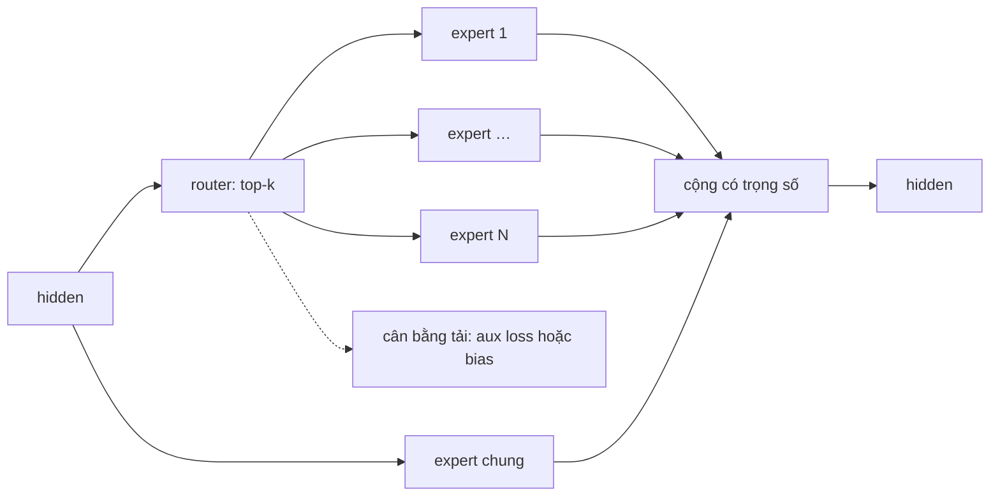

# Phase 16: Lab MoE

> **Required — deviation-log:** Log every Decision / Deviation / Surprise in § Deviation Log the moment it occurs.

## Context Links

- [phase-15](./phase-15-lab-dense-baseline.md): khung lab và mốc dense M
- plan.md: quy tắc "mỗi bậc phải thắng bậc trước ở cùng lượng tính toán"

## Overview

Thay FFN dense bằng **Mixture-of-Experts**: mỗi token chỉ đi qua k expert do router chọn. Tổng tham số tăng nhiều lần, còn tính toán cho mỗi token gần như giữ nguyên. Phase này cũng trả lời bằng số đo câu hỏi trước đó của anh: **expert có tự chuyên môn hoá theo domain (pháp luật, y tế…) không**, hay chia theo kiểu khác.

## Key Insights

- So sánh công bằng: MoE và dense có cùng **tham số kích hoạt** và cùng số token. Báo cáo cả tổng tham số, vì MoE "mua" chất lượng bằng bộ nhớ.
- Expert mịn + expert dùng chung (kiểu DeepSeekMoE): nhiều expert nhỏ, top-k lớn hơn, cộng 1 expert luôn bật.
- Cân bằng tải: aux loss truyền thống, hoặc bias không cần aux loss (kiểu DeepSeek-V3). Nếu không cân bằng, router dồn token vào vài expert (expert collapse).
- Một GPU nên không cần expert parallelism và không cần capacity factor (dropless). Cách cài đơn giản nhất: sắp token theo expert rồi lặp qua từng expert. Dễ đọc, chậm hơn grouped GEMM.
- Bộ nhớ: M-MoE khoảng 400M tổng tham số × 16 byte (AdamW + bf16) ≈ 6,4 GB, vừa 12 GB cùng activation ở seq 2048 (cần đo).

## Requirements

- `lab/layers/moe.py`: router top-k, softmax hoặc sigmoid gating, expert SwiGLU, expert chung tuỳ chọn, cân bằng tải bằng aux loss hoặc bias.
- Config: `n_experts`, `top_k`, `n_shared`, `balance: aux|bias`, `dense_first_layers`.
- Đo mỗi lần eval: tải từng expert (max/mean), entropy router, và **ma trận expert × nguồn dữ liệu** trên held-out (pháp luật, y tế, wiki, diễn đàn…).

## Architecture

## Related Code Files

- Create: `lab/layers/moe.py`, `lab/analyze_experts.py`, `lab/configs/moe/moe-s-a{1,2,3}.yaml`, `tests/test_lab_moe.py`
- Modify: `lab/model.py` (FFN `moe`, `active_params`, aux loss), `lab/config.py` (`moe`), `lab/layers/mlp.py` (độ rộng tuỳ chọn cho expert chung), `lab/train.py` (`balance_step`, log `moe_load_max`)
- Ngoài repo: chuỗi chạy `E:\llm-data\lab\logs\phase16-chain.ps1`

## Implementation Steps

1. Viết `moe.py` + test: top-1 với một expert cho kết quả bằng FFN dense; tổng trọng số gating bằng 1; gradient chảy về router.
2. Ablation ở cỡ S, cùng tham số kích hoạt với dense-S:
   - A1: 8 expert, top-2;
   - A2: 32 expert mịn, top-4, + 1 expert chung;
   - A3: cấu hình tốt nhất, aux loss vs bias.
3. Chạy M với cấu hình thắng, 2B token.
4. `analyze_experts.py`: ma trận expert × nguồn; xem token nào hay vào expert nào.
5. Báo cáo `reports/lab-16-moe.md`: bpb so với mốc dense theo **FLOPs** và theo **thời gian thực**, bảng bpb theo domain (MoE-M so với dense-M), tải expert, kết luận về chuyên môn hoá.

## Todo List

- [x] moe.py + test
- [ ] Ablation A1–A3 ở S
- [ ] Chạy M-MoE
- [ ] Phân tích expert × nguồn
- [ ] Báo cáo

## Success Criteria

- [x] `uv run --group lab pytest tests/test_lab_moe.py` pass (5 test: 1 expert = FFN dense; router có gradient ở cả aux và bias; bias kéo router bị dồn về cân bằng; tham số kích hoạt = dense + router; model MoE vẫn nhân quả).
- [ ] Không expert nào nhận tải quá 2 lần trung bình sau warmup (không collapse).
- [ ] M-MoE có bpb thấp hơn dense-M ở cùng FLOPs. Nếu không thắng thì phải giải thích được nguyên nhân trước khi sang phase 17.

## Assumptions

- **Claim:** Ở cỡ ~100M tham số kích hoạt, MoE đã thắng dense ở cùng FLOPs. **Confidence:** medium (lợi thế MoE thường rõ hơn ở cỡ lớn). **How to verify:** bước 3.
- **Claim:** Expert **không** chia theo domain rõ ràng mà theo đặc trưng cú pháp/từ vựng. **Confidence:** medium. **How to verify:** bước 4.

## Risk Assessment

| Rủi ro | Xử lý |
|---|---|
| Lặp theo expert làm chậm nhiều lần | Ghi rõ cả thời gian thực; nếu quá chậm mới dùng grouped GEMM của torch |
| Train không ổn định (router) | z-loss cho router, LR router thấp hơn, gating tính bằng fp32 |
| Thiếu VRAM ở M | Activation checkpointing hoặc giảm số expert |

Rollback: config dense-M vẫn chạy nguyên như cũ.

## Security Considerations

Như phase 15.

## Next Steps

Phase 17 thay phần lớn lớp attention bằng Gated DeltaNet, giữ FFN MoE.

## Deviation Log

- **2026-11-19 Decision:** dispatch MoE chạy eager (`torch.compiler.disable`) vì vòng lặp theo expert có shape phụ thuộc dữ liệu; phần còn lại của model vẫn được compile. Gating mặc định softmax; z-loss 1e-3 bật cho mọi cấu hình. Bias (chế độ `bias`) chỉ cộng vào điểm chọn expert, không cộng vào trọng số trộn.
- **2026-11-19 Decision:** ablation dùng đúng thiết lập của mốc `dense-s-full-lr3.0e-3` (0,5B token, LR 3e-3), chỉ đổi FFN. Tham số kích hoạt: dense-S 40,38M, A1–A3 40,41M (chênh do router). Tổng tham số: A1 92,3M; A2/A3 136,7M. A2 dùng expert rộng 280 (5×280 = 1400 ≈ 1408 của dense). A3 = A2 + cân bằng bằng bias; nếu A1 thắng A2 thì đổi A3 sang hình dạng A1 rồi chạy lại.
- **2026-11-19 Decision:** chưa quét LR riêng cho MoE: dùng LR tốt nhất của dense-S. Theo bài học phase 15, nếu cần quét thì mỗi lần phải dài ít nhất 40% tổng số token.
- **2026-11-19 Risk:** đường train MoE với `torch.compile` trên GPU chưa chạy thử (GPU đang bận dense-M). Đã kiểm tra trên CPU: bước train + `balance_step` + `analyze_experts`. Lần chạy A1 đầu tiên trong chuỗi phase 16 sẽ là bài kiểm tra đó.
- **2026-11-20 Surprise:** A1 trên GPU chạy đúng nhưng chỉ 2–4k token/s, VRAM 11,96/12 GB. Dispatch eager giữ activation của mọi expert (32k token × top-2 mỗi micro-step), làm tràn VRAM; driver WDDM của Windows lặng lẽ tràn sang RAM hệ thống thay vì báo OOM. Đã dừng A1 ở bước 9 và đo 10 bước: `micro_batch` 8 đạt 56k token/s (MFU 0,33), 4 đạt 49k. Sửa: MoE dùng `micro_batch` 8 (accum 16), batch hiệu dụng giữ nguyên nên kết quả vẫn so được với dense-S. MFU 0,33 so với 0,55 của dense-S là chi phí của dispatch eager; so sánh vẫn theo bpb ở cùng số token, không theo thời gian. Bài học: lỗi tràn VRAM trên Windows không báo OOM mà chỉ thấy qua token/s, nên phải chạy thử vài bước trước mỗi cấu hình mới.
- **2026-11-20 Deviation:** A3 chạy trên Modal H100 (`lab/modal_train.py`, credit miễn phí $30; con số $42,5 trên dashboard là usage limit, không phải credit), A2 vẫn chạy local. Benchmark dense-M trên H100 với `micro_batch` 32 đạt 513k token/s, gấp 11,2 lần 4070, MFU 0,43; build image + copy shard mất khoảng 2 phút mỗi container. Run trên cloud dùng `micro_batch` 32 (batch hiệu dụng giữ nguyên) và `ckpt_minutes` 10. Kết quả so được với run local; khác biệt duy nhất là thứ tự cộng trong accumulation.
- **2026-11-20 Result (A1–A3, 0,5B token, 40,4M tham số kích hoạt, so với dense-S 0,8245):** A1 (8 expert, top-2, aux) 0,8153 (−1,1%); A2 (32 expert nhỏ, top-4 + 1 expert chung, aux) 0,7923 (−3,9%); A3 (như A2 nhưng cân bằng bằng bias) 0,7913 (−4,0%). Cả 9 domain đều tốt hơn. Kết luận: expert nhỏ + nhiều + expert chung là yếu tố chính (A1 → A2: −2,8%). Hai cách cân bằng gần như ngang nhau (chênh 0,001, cỡ nhiễu của một seed). Tải lệch tối đa ở bước cuối: A2 1,21, A3 1,19. Bias không cần thêm loss phụ, nên chọn bias làm mặc định. Chỉ số chuyên hoá theo domain thấp (A1 0,03–0,05; A2 0,05–0,08): expert chia việc theo loại token (dấu câu/xuống dòng, hư từ, con số, danh từ Hán-Việt) chứ không theo domain. Điều này khớp với Mixtral/DeepSeek-MoE và là thêm một lý do bác bỏ ý tưởng "mỗi domain một model". A1/A2 chạy local (micro_batch 8), A3 chạy trên H100 (micro_batch 32); batch hiệu dụng như nhau.
- **2026-11-20 Result (chuyên hoá của A3):** cân bằng bằng bias cho expert chuyên hoá mạnh hơn hẳn aux loss, và tăng dần theo độ sâu (A3: lớp 0 là 0,06, lớp 7 là 0,17; A2: 0,05–0,08), với tải lệch tối đa 1,68 ở lớp cuối. Ở lớp cuối của A3, luật dồn vào e11 (12%) và e17 (11%), reference dồn vào e23/e30 (11%), văn học dồn vào e15 (8%), trong khi chia đều sẽ là 3,1% mỗi expert. Có một ít chuyên hoá theo domain, nhưng vẫn chủ yếu theo loại token. bpb gần như ngang A2, nên mức chuyên hoá thêm này không làm model tốt hơn ở cỡ S.
