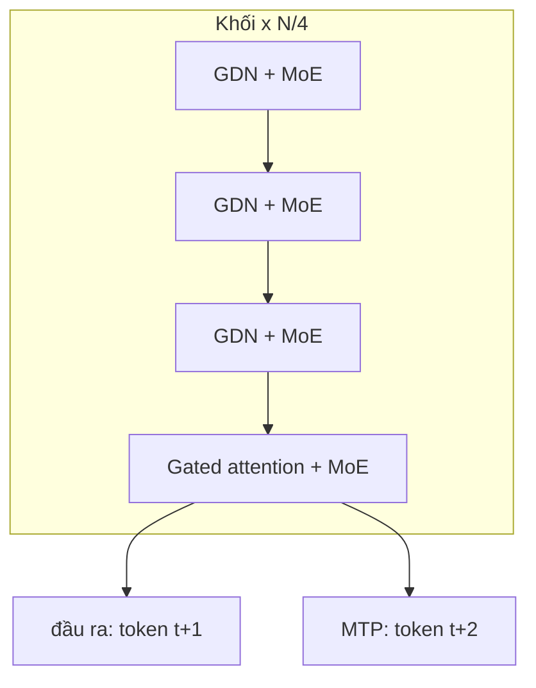

# Phase 17: Lab lai Gated DeltaNet + MTP

> **Required — deviation-log:** Log every Decision / Deviation / Surprise in § Deviation Log the moment it occurs.

## Context Links

- [phase-15](./phase-15-lab-dense-baseline.md), [phase-16](./phase-16-lab-moe.md)
- plan.md: kiến trúc đích kiểu Qwen3.8 (lai Gated DeltaNet và attention, MTP)

## Overview

Thay phần lớn lớp attention bằng **Gated DeltaNet (GDN)**. GDN là attention tuyến tính: bộ nhớ là một ma trận trạng thái kích thước cố định, cập nhật theo quy tắc delta (sửa phần dự đoán sai) và có cổng quên. Một phần nhỏ lớp vẫn giữ attention đầy đủ để tra cứu chính xác. Thêm **MTP** (dự đoán nhiều token): một module nhỏ dự đoán token t+2, giúp tín hiệu train dày hơn và dùng làm bản nháp cho speculative decoding.

## Key Insights

- GDN: suy luận tốn O(1) bộ nhớ trên mỗi token (không có KV cache lớn dần), nên context dài rẻ. Bù lại, bộ nhớ nén nên tra cứu nguyên văn kém. Vì thế mới cần lai với attention.
- Train song song cần kernel chunkwise viết bằng Triton, lấy từ thư viện `flash-linear-attention` (`fla`). Để **hiểu** thuật toán, tự viết thêm một bản đệ quy thuần PyTorch (chậm) và dùng nó làm chuẩn để kiểm tra kernel.
- Tỷ lệ tham khảo 3 GDN : 1 attention có cổng (theo thiết kế dòng Qwen3-Next; cần đối chiếu lại tài liệu gốc).
- MTP kiểu DeepSeek-V3: một khối nhỏ nhận hidden cuối + embedding token t+1, dự đoán t+2; trọng số loss 0,1–0,3.

## Requirements

- `lab/layers/gdn.py`: cả bản tham chiếu đệ quy lẫn bản dùng kernel `fla`, cùng một interface. Gồm conv ngắn, chuẩn hoá L2 cho q/k, cổng α (quên) và β (tốc độ ghi).
- `lab/layers/attention.py`: thêm cổng đầu ra (gated attention) dưới dạng tuỳ chọn.
- `lab/layers/mtp.py`: module MTP độ sâu 1, dùng chung embedding và lớp đầu ra.
- Đo thêm: bpb theo vị trí trong context, needle-in-a-haystack ở 2k/4k/8k, bộ nhớ và tốc độ khi sinh theo độ dài context, tỷ lệ chấp nhận khi dùng MTP làm bản nháp.

## Architecture

## Related Code Files

- Create: `lab/layers/{gdn,mtp}.py`, `lab/configs/hybrid/hybrid-s-h{1,2,3,4}.yaml`, `lab/eval_long_context.py`, `lab/configs/law/law-l{1-replay,2-no-replay,3-scratch}.yaml`, `tests/test_lab_gdn.py`; còn lại: config lượt chạy M của bản lai (chờ kết quả H1–H4 và A1–A3)
- Modify: `lab/model.py` (mixer `gdn`, MTP, FLOPs cho GDN), `lab/config.py` (`gdn`, `attn_gate`, `mtp`), `lab/layers/attention.py` (cổng), `pyproject.toml` (group `lab`: `flash-linear-attention==0.6.0`)
- Ngoài repo: chuỗi chạy `E:\llm-data\lab\logs\phase17-chain.ps1` (H1–H4), `phase17-law-chain.ps1` (L1–L3, chạy khi các chuỗi phase 15–17 đã thoát)

## Implementation Steps

1. Cài `fla`; chạy được trên Windows hay phải sang WSL2 thì ghi vào Deviation Log.
2. Viết GDN tham chiếu (đệ quy) + test so khớp với kernel `fla` trên input nhỏ (fp32 và bf16).
3. Ablation ở cỡ S, cùng FLOPs với MoE-S tốt nhất:
   - H1: lai 3:1;
   - H2: GDN thuần, không attention (để thấy vì sao cần lai);
   - H3: H1 có/không cổng attention;
   - H4: H1 có/không MTP.
4. Chạy M với cấu hình thắng, 2B token ở seq 2048, sau đó train ngắn thêm ở seq 8192.
5. `eval_long_context.py`: needle, bpb theo vị trí, bộ nhớ/tốc độ sinh so với MoE-M. Báo cáo cả bảng bpb theo domain (lăng kính của phase 15) cho dense-M, MoE-M và lai-M.
6. **Thí nghiệm thích nghi domain pháp lý (chốt 2026-11-19)**, trên checkpoint M của bậc thắng:
   - Dữ liệu pháp lý: `vbpl_vn`, `vbpq_org_vn`, `thuvienphapluat_vn`, `toaan_gov_vn` (bỏ `usage_scope=blocked`), `tapchitoaan_vn`, `lsvn_vn`, `plo_vn`. Shard lab đã đếm: domain `law` có 597M token train, 6,0M token held-out. Tập held-out `law` của phase 15 luôn nằm ngoài.
   - L1: train tiếp ~0,3B token, 75% pháp lý + 25% dữ liệu chung (replay).
   - L2: như L1 nhưng không replay, để đo mức quên.
   - L3: cùng kiến trúc, train từ đầu chỉ trên pháp lý với cùng FLOPs như L1.
   - Đo bpb `law` tăng bao nhiêu, bpb các domain khác mất bao nhiêu, sinh mẫu văn bản pháp lý.
7. Báo cáo `reports/lab-17-hybrid.md` + **tổng kết lab** (bảng dense/MoE/lai theo domain, kết quả L1–L3), kèm đề xuất kiến trúc cho phase 13 và cách thích nghi domain cho teacher.

## Todo List

- [x] Cài fla
- [ ] GDN tham chiếu + test so kernel (tham chiếu xong; test kernel trên GPU chạy đầu chuỗi phase 17)
- [ ] Ablation H1–H4
- [ ] Chạy M + kéo dài context
- [ ] Đo context dài + bảng bpb theo domain
- [ ] Thích nghi pháp lý L1–L3
- [ ] Báo cáo + tổng kết lab

## Success Criteria

- [ ] `uv run --group lab pytest tests/test_lab_gdn.py` pass: bản tham chiếu và kernel lệch nhau dưới ngưỡng sai số bf16.
- [ ] Lai 3:1 tìm needle tốt hơn hẳn GDN thuần ở 8k.
- [ ] Bộ nhớ khi sinh của bản lai tăng chậm hơn MoE-M theo độ dài context.
- [ ] Bậc lai thắng MoE-M về bpb ở cùng FLOPs, **hoặc** có kết luận rõ ràng vì sao không thắng ở cỡ nhỏ (kết quả âm vẫn hợp lệ).
- [ ] L1–L3 có số đo: bpb `law` của L1 so với L3 và so với checkpoint gốc, mức tăng bpb trên các domain khác của L1 so với L2.

## Assumptions

- **Claim:** `fla` chạy được với torch 2.11 trên GPU Ada (sm_89). **Confidence:** medium. **How to verify:** bước 1–2.
- **Claim:** Lợi thế của bản lai thể hiện rõ ở context dài hơn là ở bpb khi context ngắn. **Confidence:** medium.

## Risk Assessment

| Rủi ro | Xử lý |
|---|---|
| `fla` không chạy trên Windows | WSL2; nếu vẫn hỏng thì train bằng bản tham chiếu ở cỡ S (chậm nhưng đúng) |
| API `fla` thay đổi | Khoá phiên bản trong `pyproject.toml` |
| Thiếu VRAM ở seq 8192 | Activation checkpointing, batch nhỏ, tích luỹ gradient |

Rollback: config MoE-M vẫn là bậc tốt nhất.

## Security Considerations

Như phase 15.

## Next Steps — cổng quyết định

Lab chỉ chứng minh **code đúng, công thức train ổn định và xu hướng kiến trúc ở cỡ nhỏ**. Lab không chứng minh model tự train đạt chất lượng teacher. Vì vậy:

1. Kiến trúc thắng ở lab trở thành điểm xuất phát cho thang 0,1B → 1,5B của **phase 13** trên GPU thuê, với tokenizer chính thức của phase 10.
2. **Phase 12 (Qwen3.8) chỉ được bỏ** khi đủ cả ba điều kiện:
   - (a) model 1,5B của phase 13 có bpb và điểm `evalset-v1` tiếng Việt tăng đúng xu hướng scaling khi lên cỡ;
   - (b) có kế hoạch tính toán cụ thể để đạt cỡ teacher;
   - (c) có nguồn khác thay Qwen để sinh dữ liệu tổng hợp và chấm cho phase 14.

## Deviation Log

- **2026-11-19 Decision:** `fla` 0.6.0 cài native trên Windows (chạy trên `triton-windows` 3.9, không đổi torch); khoá phiên bản. Đã import được; kernel chưa chạy vì GPU đang bận dense-M.
- **2026-11-19 Decision:** ngoài bản đệ quy, tự viết thêm bản chunkwise thuần PyTorch (dạng WY, một phép giải tam giác cho mỗi chunk), để hiểu thuật toán và chạy được trên CPU. Test fp64: chunkwise khớp đệ quy tới 1e-9 cả output, state cuối lẫn gradient (T=150, 3 chunk, có state đầu). Backend `auto`: fla trên CUDA, chunkwise trên CPU.
- **2026-11-19 Decision:** lớp GDN theo fla/Qwen3-Next: một conv nhân quả kích thước 4 trên qkv + SiLU, chuẩn hoá L2 cho q/k, β = sigmoid, g = −exp(A_log)·softplus(W_a x + dt_bias) (khởi tạo kiểu Mamba-2), RMSNorm theo head có cổng silu(W_g x). Head dim K = V = d/n_heads, không mở rộng V (fla mặc định ×2), để số tham số gần với attention.
- **2026-11-19 Deviation:** ablation H1–H4 ở cỡ S dùng **FFN dense**, so với mốc dense-S, thay vì "cùng FLOPs với MoE-S tốt nhất". Lý do: tách riêng ảnh hưởng của bộ trộn token khỏi MoE, và không phải chờ kết quả phase 16. Hai cấu hình thắng (MoE + bộ trộn) gộp lại ở lượt chạy M. Ở seq 2048: dense-S 40,4M tham số, 343 MFLOP/token; H1 43,6M, 293; H2 44,7M, 276; H3 44,1M, 296; H4 47,1M, 326 (FLOPs của GDN là ước tính, docstring `flops_per_token`).
- **2026-11-19 Risk:** MTP mới được kiểm tra loss chỉ cộng khi train (eval/bpb không đổi); chưa có test chứng minh căn chỉnh t+2 ngoài việc đọc code. H4 sẽ cho thấy loss MTP có giảm hay không; tỷ lệ chấp nhận khi dùng làm bản nháp đo bằng `eval_long_context.py`.
- **2026-11-19 Decision:** `eval_long_context.py` chấm needle bằng **xếp hạng log-likelihood** (mã thật so với 9 mã ngẫu nhiên, ngẫu nhiên đúng 10%) thay vì sinh văn bản, để model 40–100M vẫn có điểm. Bộ nhớ khi sinh: đo thật bộ nhớ đỉnh và thời gian prefill; còn kích thước state khi sinh thì tính chính xác từ shape (KV cache bf16 của attention, state fp32 + đuôi conv của GDN), vì lab chưa có đường sinh từng token dùng KV cache/state. Tỷ lệ chấp nhận MTP chỉ đo ở các vị trí mà token greedy t+1 trùng token thật; ở đó lượt teacher-forced trùng hệt lượt greedy, nên tỷ lệ đo được là chính xác. Đã chạy thử từ đầu đến cuối trên CPU với model lai tí hon có MTP.
- **2026-11-19 Decision:** thêm `init_from` vào config train: lấy trọng số cuối của một run khác, optimizer và lịch LR mới; kiến trúc phải trùng, chỉ `max_seq_len` được khác (dùng cho L1/L2 và cho bước kéo dài context lên 8192). Đã kiểm tra trên CPU: nạp đúng trọng số, từ chối khi kiến trúc khác.
- **2026-11-19 Deviation:** L1–L3 viết cho **dense-M** (có checkpoint sớm nhất) thay vì "M của bậc thắng". Khi biết bậc thắng thì chạy lại chỉ cần đổi `model` và `init_from`. Mỗi run 0,3B token (572 bước, ~2 giờ ở cỡ M). L1: 76% law + 24% replay theo đúng tỷ lệ mix gốc; L1/L2 LR 6e-4 (0,3 × đỉnh của dense-M), warmup 50; L3 từ đầu, LR 2e-3. Domain law có 597M token train, nên 0,3B token chưa hết một epoch.
- **2026-11-20 Surprise:** lần đầu chạy kernel `fla` trên GPU thì train lỗi biên dịch Triton: "Both operands must be same dtype. Got fp32 and bf16". Nguyên nhân: dưới autocast, `F.normalize` trả q, k ở fp32 còn v ở bf16, mà fla dựng ma trận WY theo dtype của k. Test kernel không bắt được lỗi này vì chạy ngoài autocast. Sửa trong `_fla_gated_delta_rule`: ép q, k, beta theo dtype của v, g giữ fp32. Sau khi sửa, `tests/test_lab_gdn.py` pass 4/4 trên GPU và H2/H4 train được.
- **2026-11-20 Deviation:** H1–H4 dùng `micro_batch` 8 thay vì 16. Ở 16, VRAM tràn và Windows lặng lẽ tràn sang RAM: đo 10 bước được H2 17k so với 89k token/s, H4 5k so với 73k. Batch hiệu dụng không đổi nên vẫn so được với dense-S. Ước tính mỗi run khoảng 1,6–2 giờ.
- **2026-11-20 Deviation:** H1–H4 và L1–L3 chạy song song trên 8 H100 của Modal (cùng đợt với MoE A3) thay vì chuỗi local: dự kiến xong trong khoảng 1 giờ thay vì khoảng 17 giờ. Chuỗi `phase17-chain.ps1` và `phase17-law-chain.ps1` đã dừng. Trên cloud dùng `micro_batch` 32; batch hiệu dụng của mỗi config giữ nguyên.
- **2026-11-20 Result (L1–L3, đều 0,3B token, trên H100):** bpb/law: dense-M 0,5641 → L1 (có replay) 0,5236 (−7,2%), L2 (chỉ luật) 0,5191 (−8,0%), L3 (từ đầu, chỉ luật) 0,6243. bpb/all: dense-M 0,7268, L1 0,7265 (giữ nguyên), L2 0,7491 (+3,1%), L3 1,0726. L2 quên nhiều hơn ở domain xa luật: forum +6,0%, web +5,0%, literature +4,1%. L1 chỉ nhích +1–1,3% ở reference, forum, web, literature. Kết luận: (1) replay 24% giữ gần trọn năng lực chung mà chỉ mất 0,0045 bpb/law so với L2 → khi thích nghi thì dùng replay; (2) model chỉ học luật, cùng 0,3B token, kém xa model chung + thích nghi (0,6243 so với 0,5236), và kém cả dense-M chưa thích nghi (0,5641). Điều này ủng hộ quyết định "một model chung + thích nghi" thay vì 10 model domain. L3 không cùng tổng compute với L1 (L1 có thêm 2B token pretrain chung); muốn so cùng compute thì phải lặp lại khoảng 4 epoch kho luật (597M token).
- **2026-11-20 Surprise:** trên Modal H100, kernel GDN của fla 0.6.0 từ chối chạy vì Triton < 3.7.1 trên Hopper cho kết quả sai (fla #640), mà torch 2.11 đi kèm Triton 3.6. `tilelang` không giúp được vì backend này chỉ thay cho attention. H1–H4 vì vậy chạy trên A100 80GB: benchmark H4 đạt 250k token/s (L40S 175k, 4070 73k). `modal_train` từ chối chạy config GDN trên H100.
- **2026-11-20 Result (H1–H4, 0,5B token trên A100, so với dense-S 0,8245):** bpb/all: H1 (GDN 3:1) 0,8094 (−1,8%, ít hơn 15% FLOPs); H2 (chỉ GDN) 0,8190 (−0,7%); H3 (+ cổng attention) 0,8082; H4 (+ MTP) 0,8076. Chênh lệch H1 → H3/H4 là 0,001–0,002, mỗi cấu hình mới chạy một seed.
- **2026-11-20 Result (`eval_long_context`, train ở 2048, eval tới 8192; lượt này lỡ chạy trên CPU vì shell còn `CUDA_VISIBLE_DEVICES=` rỗng, nên cột thời gian prefill không dùng được, các cột khác không bị ảnh hưởng):**
  - bpb theo vị trí ở 4–8k token: dense-S hỏng hẳn (2–4k 1,33; 4–8k 1,60, do RoPE không ngoại suy được), còn hybrid giữ ổn định (H1 0,87/0,93; H4 0,86/0,91; H2 0,87/0,86).
  - Needle ở độ sâu 90%, độ dài 8192: dense-S 15%, H1 90%, H3 45%, H4 65%, H2 20%. Needle ở xa (độ sâu 10%) thì mọi model đều ≈ ngẫu nhiên, kể cả ở 2048. Model cỡ S chưa truy xuất xa được.
  - State khi sinh ở 8192 token: dense-S 64 MB, H1–H4 16,8 MB (−74%), H2 1,07 MB và không tăng theo độ dài.
  - MTP (H4): 69% bản nháp t+2 trùng với lựa chọn greedy, đo trên 40% vị trí (những chỗ head chính đoán đúng t+1).
  - Kết luận chọn cho cỡ M: hybrid GDN 3:1 + MoE kiểu A3; MTP giữ lại vì không làm giảm bpb mà cho phép giải mã tự suy đoán. Cổng attention chưa có bằng chứng rõ (một seed), cũng giữ vì rẻ.
- **2026-11-20 Decision (bộ eval kiến thức, anh yêu cầu):** evalset-v1 không tách được dense-S với dense-M (bpb chênh 12%): chỉ `vn_knowledge` theo `p_correct` có ý nghĩa (p = 0,004). Câu v1 kiểu đề thi dài, và cách chấm theo nhãn " A" chỉ cho kết quả ngang đoán bừa với model nền nhỏ. Đã làm:
  - Harness thêm chế độ `cloze` (chấm chính nội dung phương án; `acc`, `acc_raw`, `p_correct`; chia theo domain và độ khó), nạp được checkpoint lab (`lab:<run>`), và có `eval.compare` (bootstrap ghép cặp).
  - Bộ `vn_facts` mới: 10 agent soạn, lọc trùng (bỏ 45 câu, trong đó 25 câu trùng dữ kiện với v1), còn 1.093 câu holdout. Phân bố: 439 văn hoá–lịch sử–địa lý, 193 luật, 128 ngôn ngữ, 124 khoa học, 110 y tế, 99 kinh tế–xã hội–đời sống. Độ khó 1–5: 218/326/331/163/55. Đã nhập vào taskset ở trạng thái pending.
  - Toàn bộ 14.042 câu Global-MMLU tiếng Việt cũng ở trạng thái pending, chờ duyệt hàng loạt.
  - `manifests/evalsets/evalset-v2.yaml`: build khi anh duyệt xong.
- **2026-11-20 Result (chạy thử `vn_facts`, cloze, acc / p_correct):** dense-S 0,280; H4 0,295; Qwen2.5-0.5B 0,302; A3 0,306; dense-M 0,337; law-L1 0,362 (nhóm luật 0,477). Độ khó phân tầng rõ (dense-M: d1 0,48 → d5 0,22). So ghép cặp: S → M +5,7 điểm (p < 0,001), S → A3 +2,6 (p = 0,015), S → H4 +1,6 (p = 0,09), M → L1 ở nhóm luật +9,8 (p = 0,001). Ngưỡng phát hiện vào khoảng 2,5 điểm acc; `vi_mmlu` 14k câu sẽ hạ ngưỡng này. Các xếp hạng khớp với bpb, nên đây cũng là bằng chứng thứ hai cho kết luận MoE > hybrid > dense ở cỡ S.
- **2026-11-20 Surprise (rò rỉ eval vào shard lab):** FineWeb-2, CulturaX và sách được đọc thẳng từ canonical nên chưa từng qua decontam. Quét với evalset-v1 thấy CulturaX có 11 tài liệu (chạm 32 câu: 31 ViQuAD2, 1 câu nháp), FineWeb-2 có 8 tài liệu (chạm 24 câu: 19 ViQuAD2, 5 VMLU); 51 nguồn qua s4 đều sạch. Sửa: `EvalIndex()` tự gồm mọi bộ eval đã build (dùng cho s4, `lab.data_prep`, export decision studio); `lab.data_prep` lọc mọi nguồn; đã token hoá lại hai nguồn trên. Các run lab trước ngày 20/11 train trên shard có 19 tài liệu rò rỉ (trên tổng 2,3 triệu); ảnh hưởng tới điểm ViQuAD2/VMLU của chúng không đáng kể, nhưng vẫn ghi lại.
- **2026-11-20 Result (combo-S = GDN 3:1 + cổng attention + MoE kiểu A3 + MTP, 0,5B token, A100):** bpb/all 0,7804. So với dense-S 0,8245 là −5,3%; với A3 là −1,4%; với H4 là −3,4%. Nếu hai lợi ích cộng dồn trọn vẹn thì sẽ là 0,774, nên thực tế cộng dồn được khoảng 80%. Cả 9 domain đều tốt nhất trong các run cỡ S (law 0,6131, literature 1,0302). 144,2M tham số tổng, 47,9M kích hoạt; 133k token/s trên A100. Đây là cấu hình chọn cho cỡ M.
  - `vn_facts` (cloze, bản nháp 1.093 câu): combo-S 0,299, ngang A3 0,306 (chênh −0,6, p = 0,73) và hơn dense-S +1,9 (p = 0,045; `p_correct` +1,6, p = 0,004). Phần bpb mà hybrid + MTP thêm vào không chuyển thành nhớ dữ kiện tốt hơn: sức nhớ kiến thức đến từ tổng số tham số (MoE 137–144M) chứ không từ bộ trộn token. Khi chọn kiến trúc cho cỡ M thì bpb và eval kiến thức đo hai thứ khác nhau, phải theo dõi cả hai.
- **2026-11-20 Surprise (lỗi đếm đôi trong decontam):** lần quét đầu với v1 + v2 báo 19 nguồn bị nhiễm, kể cả các nguồn đã sạch qua s4. Nguyên nhân: v2 giữ lại các câu của v1 với cùng id, mà `EvalIndex.add` thêm 13-gram của chúng hai lần, nên `matches()` đếm đôi số gram trùng và ngưỡng phủ 50% thực chất tụt xuống 25%. Sửa: mỗi id chỉ được nạp một lần; có test hồi quy trong `tests/test_process_clean.py`. Lỗi chỉ xuất hiện khi có từ hai bộ eval dùng chung câu, tức là sau khi build v2; các lần lọc trước (chỉ có v1) không bị ảnh hưởng.
